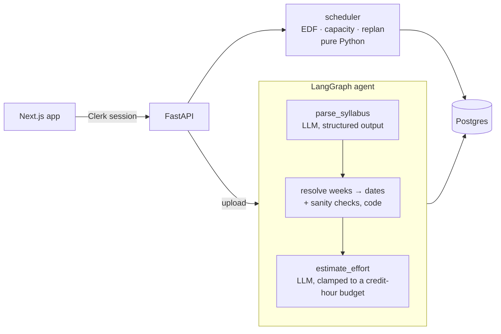

# Cadence

**Syllabi in, study schedule out.** Upload your course syllabi; Cadence reads every
graded item, its weight and its deadline, estimates the work, and plans study time
around your classes and commitments. When something changes it replans — moving
only what has to move.

<!-- demo GIF -->

The design rule behind it: **the language model reads, plain code decides.** An LLM
turns messy syllabi into structured data. Everything after that — date arithmetic,
scheduling, replanning, learning from check-ins — is deterministic, tested code.
The same inputs always give the same plan.

## What it does

- **Reads real syllabi** (PDF or Word, tables or prose): assignments, weights, due
  dates *or* due weeks, handout weeks, grading categories, attendance, and class
  meeting times.
- **Never invents a deadline.** An exam marked "TBA" stays undated and is surfaced
  for the user to fill in. Class times read from a syllabus wait in a confirm step
  with sanity checks (a 4h40m lecture is almost certainly a typo).
- **Plans around your life**: a study window, a daily cap, class meetings, work
  shifts and days off. Earliest-deadline-first, spread into ~2-hour sittings,
  never before an assignment is handed out.
- **Replans with minimal churn.** Every still-valid block stays exactly where it
  was; only displaced hours move, and the UI says what changed ("Moved 1 block").
- **Learns.** A weekly check-in records real hours; a course that runs long gets a
  higher effort multiplier and its untouched tasks are re-estimated.
- **Fits your tools**: drag to pin blocks, week/day/month views, `.ics` export.

## Extraction accuracy

Every change to the extraction prompt is scored by `evals/run.py` against
hand-checked answer files: 7 synthetic syllabi built to break extractors
(`evals/syllabi/`) plus 2 real ones kept out of the repo.

| | Claude Haiku 4.5 | Claude Sonnet 4.5 |
|---|---|---|
| Graded items found | 65/65 | 65/65 |
| Item kind (deliverable / category / excluded) | 65/65 | 65/65 |
| Grade weights | 65/65 | 65/65 |
| Due dates or due weeks | 48/48 | 48/48 |
| Handout weeks | 9/9 | 9/9 |
| Undated items kept undated | 17/17 | 17/17 |
| Class meeting slots | 19/19 | 19/19 |
| **Invented dates** | **0** | **0** |
| Extra (non-graded) items | 0 | 0 |
| Avg. time per syllabus | 5.1 s | 7.8 s |

Haiku is the default: same accuracy on this set, faster and cheaper.

It didn't start there. The eval caught, and the fixes now guard against:

- a "Class Participation" item invented from a paragraph about classroom
  behaviour, with no weight in the grade;
- workshop drafts ("graded as part of participation") emitted as duplicate
  essays with the wrong dates;
- TBA exams labelled as grading categories instead of undated events;
- a model doing its own week-to-date arithmetic ("the Friday of Week 13")
  and landing on a Saturday two weeks late. Week arithmetic now always
  happens in code.

The test syllabi cover dates hidden in schedule tables, release-plus-offset week
deadlines, six date formats in one document, a syllabus with no dates at all,
attendance/clicker/quiz look-alikes, a spring term whose dates omit the year, and
a syllabus written entirely in prose. The answer files are themselves tested: a
perfect extraction built from each must score 100%.

## Architecture



- **One writer of the schedule.** `_reschedule` in `app/api/routes.py` is the only
  code that writes study blocks, and it never calls an LLM. Uploads, date fixes,
  new commitments, drags and check-ins all go through it.
- **The scheduler is pure.** `app/scheduler/` takes tasks and per-day capacity and
  returns blocks. No database, no I/O — which is why it has 40+ fast unit tests.
- **Provider-agnostic LLM layer.** `app/llm/provider.py` is the only file that
  touches a vendor SDK (`LLM_PROVIDER=anthropic|openai`).
- **Streaming upload.** `POST /api/syllabus/stream` sends server-sent events per
  agent step so the UI shows progress while the model reads.

### Scheduling, briefly

1. **Capacity per day** = study window − commitments (classes, shifts, days off),
   capped at max hours/day, snapped to a 15-minute grid.
2. **Placement**: earliest deadline first; each task is spread over
   `ceil(hours / 2)` days chosen evenly across its window (handout date → due
   date, at most 21 days out), with mop-up passes so a 15-minute remainder never
   strands work.
3. **Replanning** keeps every previous block whose task, day and exact slot are
   still valid, schedules only what's left, and — if holding blocks would strand
   urgent work — releases the lowest-priority ones one at a time instead of
   reshuffling everything. Churn (kept / moved / added) is reported on every
   rebuild.

## Stack

FastAPI · SQLAlchemy 2 · Alembic · Postgres · LangGraph · Anthropic/OpenAI ·
Next.js 16 · React 19 · Tailwind 4 · react-big-calendar · Clerk · Docker Compose

## Running locally

```bash
cp .env.example .env              # add ANTHROPIC_API_KEY (and Clerk, optional)
cp web/.env.example web/.env.local
docker compose up -d --build      # Postgres + API on :8000
docker compose exec api alembic upgrade head
cd web && npm install && npm run dev   # app on :3000
```

Without Clerk keys, leave `CLERK_ISSUER` blank: auth is off and everyone is a
single local "demo" user. With them, every API call needs a verified Clerk
session and users only ever see their own data.

## Deploying

| Piece | Host | Config |
|---|---|---|
| Next.js app | Vercel (root directory `web`) | `API_ORIGIN`, Clerk keys |
| FastAPI | Render, Docker | `render.yaml`; migrations run on every start |
| Postgres | Neon | `DATABASE_URL` (any `postgres://` URL works) |

The browser only ever talks to the Vercel origin; `/api/*` is proxied to the API,
so there is no CORS setup and Clerk's session cookie reaches the backend. GitHub
Actions runs the API tests against Postgres and lints and type-checks the web app
on every push.

## Tests and evals

```bash
docker compose exec api pytest -q            # unit + integration (real Postgres)
docker compose exec api python -m evals.run  # extraction accuracy (calls the LLM)
docker compose exec api python -m evals.run --model claude-sonnet-4-5
```

Integration tests run against a real Postgres, not SQLite — timezone-aware
datetimes and UUID columns are exactly the kind of thing SQLite hides. Each test
runs in a rolled-back transaction.

## Layout

| Path | What lives there |
|---|---|
| `app/agent/` | LangGraph graph; tools for parsing, effort, dates, meetings |
| `app/scheduler/` | `core.py` placement + replanning, `capacity.py`, `learning.py` |
| `app/api/routes.py` | HTTP surface; the single schedule writer |
| `app/auth.py` | Clerk session verification (JWKS, issuer, azp) |
| `app/ical.py` | `.ics` export |
| `evals/` | answer files, synthetic syllabi + their generator, scorer, runner |
| `web/src/` | Next.js app: calendar, upload, check-in, availability, landing |
| `tests/` | ~190 tests: scheduler, replan, capacity, API, auth, evals |
